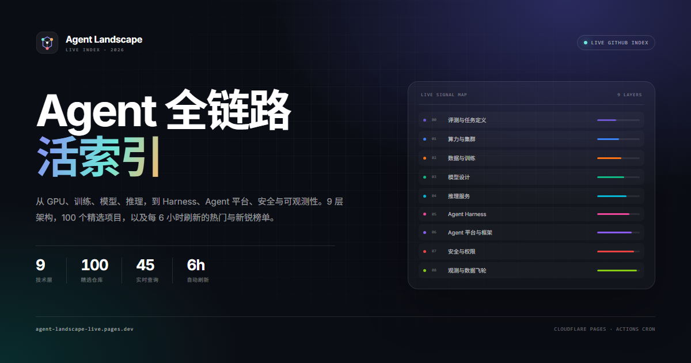

# Agent Landscape · Live

> 一张图看懂 Agent 全链路，再用一份每 6 小时更新的榜单追踪它。

**Live site:** https://agent-landscape-live.pages.dev/



## 这是什么

Agent Landscape 把 Agent 系统拆成 9 层：

`评测与任务定义 → 算力与集群 → 数据与训练 → 模型与架构 → 推理与服务 → Harness 与运行时 → Agent 平台与框架 → 安全与对齐 → 可观测与运维`

站点提供三种视角：

| 模式 | 来源 | 排序 |
| --- | --- | --- |
| **精选 Curated** | 架构图中的 100 个代表项目 | 按阶段覆盖度编排，不按 Stars |
| **最热 Hot** | GitHub Search + topic 查询 | Stars 降序 |
| **新锐 Rising** | 最近 12 个月创建的仓库 | Stars 降序 |

精选仓库附带实时 Stars、语言、最近 push 时间与 topics。最热 / 新锐每 6 小时由 GitHub Actions 重新抓取，前端只读取同源静态 JSON，不会暴露 Token。

## 数据管线

```text
scripts/queries.json
        │  45 组 topic 查询
        ▼
scripts/fetch-live.mjs ── GitHub REST Search API
        │  质量过滤 / 去重 / 元数据补全
        ▼
data/live.json ── GitHub Actions（每 6 小时）
        │
        ▼
Cloudflare Pages ── index.html + assets + data
```

质量过滤会排除 awesome 榜单、课程、教程、书籍、面试材料、已归档 / 停止维护的项目，以及明显跑题的仓库。它不是完美的推荐系统，而是一份可追溯的索引。

## 本地预览

```bash
# Python 3
python -m http.server 8000

# 或 Node
npx serve .
```

打开 <http://localhost:8000>。

## 本地刷新数据

需要 GitHub Token（只读 public repo 即可）：

```powershell
# Windows PowerShell
$env:GITHUB_TOKEN = gh auth token
node scripts/fetch-live.mjs
```

```bash
# macOS / Linux
export GITHUB_TOKEN=$(gh auth token)
node scripts/fetch-live.mjs
```

脚本会读取 `data/curated.json` 中的 100 个仓库，补全元数据，并生成 hot / rising 结果到 `data/live.json`。新锐（rising）结果约每天刷新一次（距上次 ≥ 22 小时），其余运行复用 `live.json` 中的快照；设置 `FORCE_RISING=1` 可强制刷新（Actions 手动触发时勾选 `force_rising`）。GitHub 认证搜索限制为 30 次/分钟，脚本内置 2.2 秒间隔，完整运行约 2 分钟。

## 部署

站点独立部署在 **Cloudflare Pages**，不占用个人 GitHub 站点路径：

- **Live site:** https://agent-landscape-live.pages.dev/

仓库已配置 `.github/workflows/deploy.yml`：

1. push 到 `main`，或手动触发 `workflow_dispatch`；
2. Actions 运行 `node scripts/fetch-live.mjs` 刷新 `data/live.json`；
3. 把刷新后的快照提交回仓库（`[skip ci]`，不会触发递归构建）；
4. 打包 `index.html` / `assets/` / `data/` 并用 Wrangler 部署到 Cloudflare Pages。

定时任务：

```yaml
schedule:
  - cron: "17 */6 * * *"
```

### 需要的 GitHub Secrets

| Secret | 说明 |
| --- | --- |
| `CLOUDFLARE_API_TOKEN` | Cloudflare API Token，权限 `Account / Cloudflare Pages / Edit` |
| `CLOUDFLARE_ACCOUNT_ID` | Cloudflare 账户 ID（Dashboard 右侧可见） |

### 本地部署

```bash
npx wrangler login
npx wrangler pages project create agent-landscape-live --production-branch main
npm run build:dist && npx wrangler pages deploy dist --project-name=agent-landscape-live
```

`wrangler.toml` 已经声明 `pages_build_output_dir = "dist"`，配置好 `CLOUDFLARE_API_TOKEN` / `CLOUDFLARE_ACCOUNT_ID` 环境变量后，也可以直接用 `npx wrangler pages deploy`。

## 目录

```text
.
├─ index.html                 页面结构
├─ assets/
│  ├─ app.js                  数据加载、筛选、渲染、交互
│  ├─ styles.css              视觉系统与响应式
│  ├─ agent-architecture.svg  可编辑架构图
│  ├─ agent-architecture.pdf  矢量 PDF（30 × 50.42 in）
│  ├─ agent-architecture-a1.pdf
│  ├─ agent-architecture.png  预览图
│  ├─ favicon.svg
│  └─ og.png                  社交分享图
├─ data/
│  ├─ curated.json            9 个阶段 / 100 个精选仓库
│  └─ live.json               实时元数据与 hot / rising 结果
├─ architecture/
│  ├─ agent-architecture.svg  Figma 可编辑源文件
│  ├─ build_svg.py            架构图生成脚本
│  ├─ export_pdf.py           SVG → 矢量 PDF
│  ├─ figma-plugin/           批量添加原生 Hyperlink
│  └─ README.md               架构图说明
├─ scripts/
│  ├─ queries.json            45 组 GitHub topic 查询
│  ├─ fetch-live.mjs          抓取、过滤、生成 live.json
│  ├─ export_curated.py       从架构图生成 curated.json
│  └─ make_og.py              生成社交分享图
└─ .github/workflows/pages.yml
```

## 架构图

- **SVG**：`assets/agent-architecture.svg`，可直接导入 Figma 编辑，包含 100 个 GitHub 超链接。
- **矢量 PDF**：`assets/agent-architecture.pdf`，30 × 50.42 in，适合评审与打印。
- **A1 海报**：`assets/agent-architecture-a1.pdf`，594 × 841 mm。
- **Figma 插件**：`architecture/figma-plugin/` 可在 SVG 导入后为仓库文本批量添加原生超链接。

## 说明

- Stars 与活跃度会变化，榜单只代表抓取时刻的快照。
- 精选是编辑视角，不构成对任何项目的推荐或背书。
- 各仓库遵循其各自的许可证。
